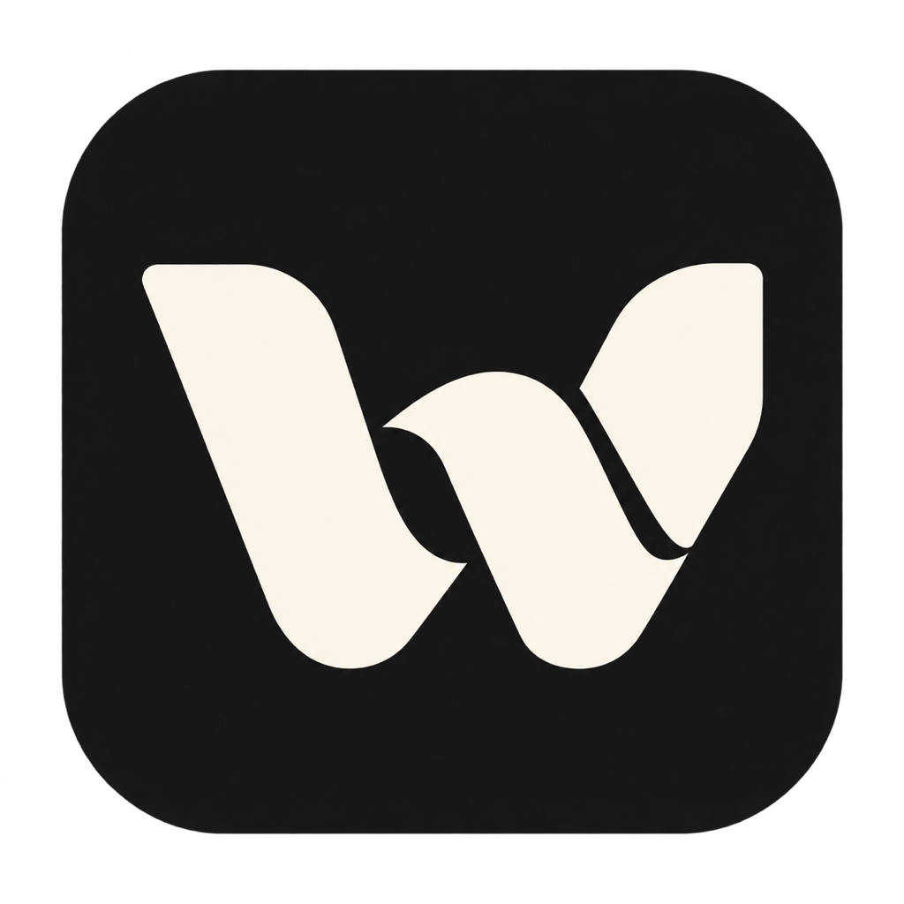
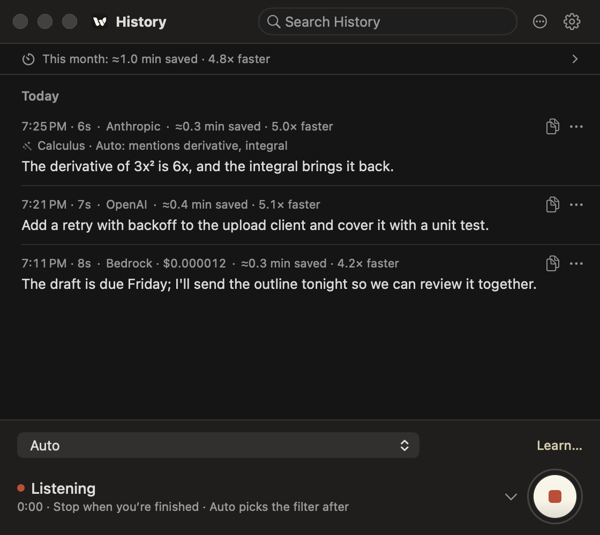

<p align="center">
  
</p>

<h1 align="center">WorkFlow</h1>

<p align="center">
  Hold <kbd>Fn</kbd> or a shortcut, speak, and get text written the way you want.
</p>

WorkFlow is my personal Mac dictation and meeting-transcription app, built by [Ben Suo (picturesuo)](https://github.com/picturesuo) and published open source (MIT) so you can fork it and adapt it to how you write. There's no WorkFlow subscription. Speech-to-text runs on your Mac with Parakeet or Whisper, so transcription needs no account and has no API fees. Optional AI cleanup rewrites what you said through a provider you pick and pay directly.

<p align="center">
  
</p>
<p align="center"><sub>The main window from the current source, rendered offscreen by the test suite in a synthetic listening state. The dictations, times, and figures are synthetic; no microphone or live speech was used.</sub></p>

## What it costs

**If you dictated continuously for 30 days**, around the clock, with cleanup on Amazon Bedrock's Nova Micro, AWS would charge roughly **$1.60-$2.35** for cleanup at its current price. Transcription on your Mac has no API fees.

- That's a rough estimate of the provider's cleanup charge only, not a quote or a promise. Hardware and electricity aren't included, mode, language, and model change it, and WorkFlow isn't built to record nonstop.
- By default WorkFlow pauses Bedrock cleanup once its own estimate for the month reaches $0.25, about 3-5 days at that pace. The stop is WorkFlow's estimate, not an AWS billing cap.
- OpenAI and Anthropic bill at their own rates, which WorkFlow doesn't estimate or cap. Only some Claude and ChatGPT plans include API credits.

The math, one real month, and plan terms are in the [quickstart](docs/QUICKSTART.md#what-it-costs).

## Features

- **Time saved while you talk.** The main window shows this month's minutes saved and how many times faster than typing, counted from your estimated active speech, so pauses, thinking, and waiting for text aren't counted. The typing speed it compares with is in Settings.
- **Custom filters and Auto.** Tell cleanup how a class, job, or app wants text written, in your own words or drafted with AI. Auto picks a filter from trigger phrases on your Mac, with no extra request.
- **Learn from finished writing.** Drop in a document you finished from your dictations and WorkFlow keeps small style preferences it can check against your edits, each one reversible.
- **Your own key, built in.** Native Amazon Bedrock, OpenAI, and Anthropic support, plus Azure OpenAI, local Ollama, or any OpenAI-compatible API.

Cleanup rewrites what you said and never answers it, and a failed or unsafe rewrite gives you your original transcript. How each feature works is in the [quickstart](docs/QUICKSTART.md).

## Make it yours

WorkFlow is shaped around one person's writing, so the best way to get the features you want is to fork it and change it. Much of it is already adjustable in Settings:

- **Custom filters:** Settings > Cleanup. Write your own, or use Create with AI. The card lives in `OpenSuperWhisper/CustomCleanupFilterViews.swift`.
- **Provider:** Settings > Provider & Cost. Providers are listed in `OpenSuperWhisper/Services/CleanupProvider.swift`.
- **Vocabulary:** Settings > Personalize > Personal vocabulary, for names and terms the recognizer gets wrong.
- **Shortcut:** Settings > Dictation > Shortcut.

Bug reports and focused bug fixes are welcome; see [CONTRIBUTING.md](CONTRIBUTING.md).

## Privacy

Audio never leaves your Mac. With cleanup on, only transcript text goes to the one provider you pick. **Send** in Create with AI shares your request and any pasted example. **Learn** shares only the short matched edits with a few words around each, and **Check matches** shares nothing; the document itself is read on your Mac and not stored. New dictations keep their original transcript on your Mac until you delete them. Keys live in macOS Keychain, and credentials and transcripts are never logged.

## Install

WorkFlow installs from source, and the steps below build `master`. There's no notarized download yet; do not bypass Gatekeeper for an unsigned build. Hand this to a coding agent on your Mac:

```text
Install WorkFlow from https://github.com/picturesuo/WorkFlow by following
docs/AGENT_SETUP.md in that repository. Clone with submodules, install the
build dependencies, run the focused tests, then run Scripts/install-local.sh
and open /Applications/WorkFlow.app. Never ask me for an API key: I will type
it into WorkFlow's secure settings field myself. Leave Apple signing identity,
Microphone, Accessibility, and Input Monitoring approvals to me.
```

By hand:

```bash
git clone --recurse-submodules https://github.com/picturesuo/WorkFlow.git
cd WorkFlow
brew install cmake libomp rust
./Scripts/install-local.sh
open /Applications/WorkFlow.app
```

Requirements: Apple Silicon, macOS 14 or newer, Xcode, Homebrew, Rust, and Git. macOS 26 needs an Apple-issued signing identity so microphone permission works. See the [quickstart](docs/QUICKSTART.md) for permissions and provider setup.

## Development

<details>
<summary>Headless test command</summary>

```bash
WORKFLOW_TEST_BUNDLE_ID="com.picturesuo.WorkFlow.fmtest.run$$"
DEVELOPER_DIR=/Applications/Xcode.app/Contents/Developer \
xcodebuild test \
  -scheme OpenSuperWhisper \
  -derivedDataPath build \
  -destination 'platform=macOS,arch=arm64' \
  -only-testing:OpenSuperWhisperTests \
  -skip-testing:OpenSuperWhisperTests/ClipboardUtilPasteIntegrationTests \
  -skip-testing:OpenSuperWhisperTests/ClipboardUtilKeyboardLayoutTests \
  -skip-testing:OpenSuperWhisperTests/KeyboardLayoutProviderTests \
  -skip-testing:OpenSuperWhisperTests/IndicatorWindowGeometryTests/testWindowKeepsPanelSizeAfterPresent \
  -skip-testing:OpenSuperWhisperTests/ClipboardRestoreTests/testMissingTargetDoesNotRedirectPasteAndKeepsTranscriptOnClipboard \
  CODE_SIGNING_ALLOWED=NO \
  PRODUCT_BUNDLE_IDENTIFIER="$WORKFLOW_TEST_BUNDLE_ID"
```

The skipped suites launch TextEdit, switch the keyboard layout, or show a panel, and the skipped `ClipboardRestoreTests` case overwrites the system clipboard; run them interactively, by hand. The separate bundle identifier keeps the test host out of WorkFlow's own preferences, and the shell PID suffix gives each run its own preferences domain so concurrent runs do not overwrite each other. Pass the same `WORKFLOW_TEST_BUNDLE_ID` to `build-for-testing` and `test-without-building` when you split the steps. Releases follow [docs/RELEASING.md](docs/RELEASING.md).

</details>

## License

MIT, see [LICENSE](LICENSE). WorkFlow started from [Starmel/OpenSuperWhisper](https://github.com/Starmel/OpenSuperWhisper) under the MIT license and keeps its copyright notice; OpenSuperWhisper's commit history and contributors are in that repository. [zachlatta/freeflow](https://github.com/zachlatta/freeflow) informed WorkFlow's pipeline research. The WorkFlow changes built on that foundation, including AI cleanup and its providers, custom filters and Auto, Learn from finished writing, and time saved, are my own work. See [NOTICE](NOTICE). Security reports: [SECURITY.md](SECURITY.md).
